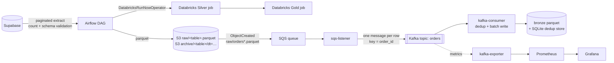

# Supabase → Airflow → S3 → Databricks + S3 → SQS → Kafka

An end-to-end data pipeline built as a portfolio project. It shows two data paths that share one object store:

- **Batch:** Airflow extracts tables from Supabase, validates them, lands them in S3 and triggers **Silver** and **Gold** jobs in Databricks.
- **Streaming:** every new `raw/orders*.parquet` object triggers an S3 event → SQS → Kafka, and a consumer writes deduplicated records to a **bronze** layer.

Everything runs locally with Docker Compose, including Airflow, Kafka, Prometheus and Grafana.

> The Databricks jobs (Silver and Gold) live in the Databricks workspace. This repository only triggers them and documents their contract (see [`databricks/README.md`](databricks/README.md)).

---

## Architecture



### Batch path (Airflow)

DAG `ecommerce_data_pipeline` runs daily at 14:00 (`Europe/Warsaw`), without catch-up and with at most one active run.

| Task | What it does |
| --- | --- |
| `extract` (mapped per table) | Fetches all rows page by page, checks the row count against Supabase's `count`, rejects empty tables and missing required columns, then writes parquet atomically (temp file + rename). |
| `upload` (mapped per table) | Uploads to `archive/<table>/dt=<date>/` (history) and `raw/<table>.parquet` (latest). Compares the remote size with `head_object` before moving the local file to `sent/`. |
| `process_silver` | Runs the Silver job in Databricks (`DatabricksRunNowOperator`). |
| `process_gold` | Runs the Gold job after Silver succeeds. |

Failed validation raises `AirflowFailException`, so bad data never reaches S3.

### Streaming path (S3 → SQS → Kafka → bronze)

- `scripts/setup_s3_events.py` creates the SQS queue and an S3 notification for `raw/orders*.parquet`.
- `ingestion/s3/sqs_listener.py` reads the event, loads the parquet file and publishes each row to Kafka. The message key is `order_id`, so events of one order stay in one partition. The message is deleted from SQS only after all rows are sent. If anything fails, it returns after the visibility timeout.
- `ingestion/kafka/producer.py` builds a **deterministic `event_id`** = `sha256(bucket:key:etag:row_index)`. Re-delivering the same file creates the same IDs.
- `ingestion/kafka/consumer.py` reads with `enable_auto_commit=False`, writes a batch of up to 500 rows (or every 30 s), marks the IDs as processed in SQLite, and only then commits offsets.

Kafka delivers at-least-once, so duplicates are expected. The consumer and the SQLite store (`ingestion/kafka/deduplication.py`) remove them within a run. Duplicates that survive a crash between the write and `mark_processed` are resolved in Silver by `_event_id`.

---

## Tech stack

| Area | Tools |
| --- | --- |
| Orchestration | Apache Airflow 3.3 (CeleryExecutor, Redis, PostgreSQL) |
| Source | Supabase (Python client) |
| Storage and events | AWS S3, SQS, boto3 |
| Streaming | Apache Kafka 4.1 (KRaft), kafka-python, kafka-ui |
| Processing | Databricks jobs (Delta Lake, PySpark), external to this repo |
| Data | pandas, pyarrow |
| Monitoring | Prometheus, kafka-exporter, Grafana |
| Packaging | Docker Compose, Dockerfiles per component |
| Tests | pytest |

---

## Repository layout

```
.
├── airflow/
│   ├── dags/ecommerce_pipeline.py    # DAG: extract → upload → Silver → Gold
│   ├── Dockerfile                    # Airflow image + providers
│   └── requirements.txt
├── ingestion/
│   ├── config.py                     # settings from env, required columns per table
│   ├── supabase/
│   │   ├── extract.py                # paginated extract to parquet
│   │   └── validation.py             # row-count and schema checks
│   ├── kafka/
│   │   ├── producer.py               # deterministic event_id, send per row
│   │   ├── consumer.py               # batched bronze writer
│   │   └── deduplication.py          # SQLite store of processed event_ids
│   ├── s3/sqs_listener.py            # SQS → parquet → Kafka
│   ├── Dockerfile
│   └── requirements.txt
├── databricks/README.md              # contract of the Silver and Gold jobs
├── scripts/setup_s3_events.py        # one-time SQS queue + S3 notification setup
├── monitoring/                       # Prometheus config, Grafana datasource provisioning
├── tests/                            # extraction, validation, deduplication
├── docs/                             # architecture, data dictionary, failure scenarios
├── docker-compose.yaml
├── requirements-dev.txt
└── .env.example
```

---

## Getting started

### Prerequisites

- Docker and Docker Compose
- A Supabase project with the tables `customers`, `orders`, `order_items`, `products`, `payments`
- An AWS account with an S3 bucket and an IAM user that can use S3 and SQS
- A Databricks workspace with the Silver and Gold jobs and a personal access token
- Python 3.12+ (only for `setup_s3_events.py` and the tests)

### 1. Configure the environment

```bash
cp .env.example .env
```

Fill in `.env`. Never commit it (it is in `.gitignore`).

| Variable | Used by | Description |
| --- | --- | --- |
| `SUPABASE_URL`, `SUPABASE_KEY` | extract | Supabase project URL and API key |
| `AWS_ACCESS_KEY_ID`, `AWS_SECRET_ACCESS_KEY` | upload, listener, setup | AWS credentials (boto3 reads these names) |
| `AWS_REGION` | all AWS calls | e.g. `eu-north-1` |
| `S3_BUCKET` | upload, listener, setup | bucket name, not an ARN |
| `SQS_QUEUE_NAME` | listener, setup | queue name, default `s3-orders-events` |
| `KAFKA_BOOTSTRAP_SERVERS`, `KAFKA_TOPIC` | producer, consumer | overridden to `kafka:9092` inside Compose |
| `AIRFLOW_UID` | Compose | host UID for mounted folders, default `50000` |
| `FERNET_KEY` | Airflow | encryption key for stored connections (see below) |
| `AIRFLOW__API_AUTH__JWT_SECRET` | Airflow | JWT secret for the API server |
| `AIRFLOW_ADMIN_PASSWORD` | Airflow | password for the `admin` user, default `admin` |
| `DATABRICKS_SILVER_JOB_ID`, `DATABRICKS_GOLD_JOB_ID` | DAG | job IDs from Databricks → Workflows |

Generate a Fernet key before the first start:

```bash
docker run --rm apache/airflow:3.3.2 python -c "from cryptography.fernet import Fernet; print(Fernet.generate_key().decode())"
```

### 2. Prepare host folders

On Linux or WSL, the Airflow and consumer containers write to mounted folders as UID `50000`:

```bash
mkdir -p data airflow/logs
sudo chown -R 50000:0 data airflow/logs
```

### 3. Create the SQS queue and S3 notification (once)

```bash
pip install -r requirements-dev.txt
python scripts/setup_s3_events.py
```

### 4. Create the Databricks connection in Airflow

Do not put the token in `.env`. In the Airflow UI go to **Admin → Connections → +**:

- Connection Id: `databricks_default`
- Connection Type: `Databricks`
- Host: `<workspace>.cloud.databricks.com` (without `https://`)
- Login: `token`
- Password: your personal access token

### 5. Start the stack

```bash
docker compose up -d --build
```

| Service | URL | Notes |
| --- | --- | --- |
| Airflow | http://localhost:8080 | `admin` / `AIRFLOW_ADMIN_PASSWORD` |
| Kafka UI | http://localhost:8085 | topic `orders`, consumer group `orders-bronze-writer` |
| Prometheus | http://localhost:9090 | targets `kafka` and `prometheus` should be `UP` |
| Grafana | http://localhost:3000 | Prometheus datasource is provisioned automatically |

The DAG is paused on creation. Unpause it in the UI and trigger a run to start the batch path.

---

## Testing

```bash
pip install -r requirements-dev.txt
pytest -q
```

The tests use fakes instead of live services: a fake Supabase client for pagination, plus validation and deduplication logic against a temporary SQLite file.

---

## What was verified

Verified locally on Docker Compose:

- An Airflow run completed all tasks, including the Databricks Silver and Gold jobs.
- S3 contains `raw/`, `archive/`, `silver/` and `gold/` objects.
- The `orders` topic received 10,000 messages, and the consumer group `orders-bronze-writer` advanced its offsets through them.
- Prometheus scrapes both targets (`kafka` and `prometheus`).

---

## Design decisions

- **Validate before upload.** Row counts are checked against Supabase's own count, and required columns are checked before any file leaves the container.
- **Atomic local writes.** Parquet goes to a temporary file first and is renamed into place, so partial files are never picked up.
- **Two S3 layers.** `archive/` keeps every extract by date; `raw/` always holds the latest version, and only `raw/orders*` triggers the stream.
- **Idempotent streaming.** Deterministic event IDs make replays safe; deduplication runs in the consumer and again in Silver.
- **Offsets committed after writes.** A crash before the commit causes a replay, not a loss.
- **Secrets stay out of code.** Credentials come from `.env`, and the Databricks token lives in Airflow's connection store.

## Known limitations

- Kafka is more than this data volume needs. It is here to demonstrate the integration, and a plain batch load would be enough for production at this scale.
- Bronze deduplication is not fully transactional. A crash between the parquet write and `mark_processed` can leave duplicates in bronze; Silver resolves them by `_event_id`.
- The Databricks job code is not in this repository.
- Python dependencies are not pinned to exact versions yet.

## Roadmap

- Pin dependency versions and add a Dockerfile-based CI run for `pytest`
- Add a Grafana dashboard exported as JSON to `monitoring/grafana/provisioning/dashboards/`
- Alert rules for consumer lag and failed DAG runs

---

## Author

**Paweł Drwal** · [@Drwalpawel20](https://github.com/Drwalpawel20)
