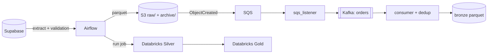

# Architektura

Dwa równoległe przepływy:
1. **Batch:** Airflow pobiera tabele raz dziennie, waliduje, wysyła do S3 i uruchamia joby Databricks (Silver → Gold).
2. **Streaming:** każdy nowy plik `raw/orders*.parquet` trafia przez SQS i Kafkę do warstwy bronze z deduplikacją.

Kafka jest tu do demonstracji integracji. Przy tak małym wolumenie sam batch byłby wystarczający.
